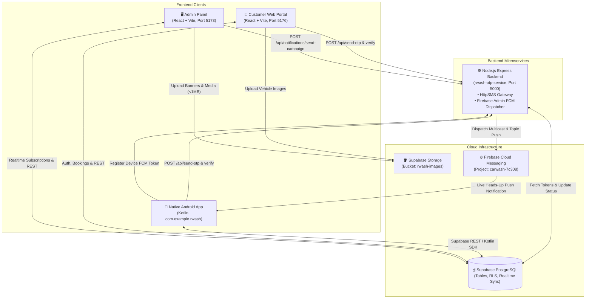

# 🚗 RWash — Complete System Architecture, File Structure & Working Model

---

## 📌 1. High-Level System Architecture

RWash is an end-to-end On-Demand Doorstep Car Wash & Detailing Platform designed to support **Web (Customer & Admin)**, **Backend Microservices (OTP & FCM)**, and a **Native Android Mobile App**.



---

## 📂 2. Complete File & Directory Architecture

```
CarWash/
│
├── 📄 run-servers.js                 # Unified Node.js runner to start Client, Admin & Backend in parallel
├── 📄 start_servers.bat              # One-click Windows desktop batch launcher
├── 📄 google-services.json           # Firebase Android app config (com.example.rwash)
├── 📄 serviceAccountKey.json         # Firebase Admin SDK Private Key (carwash-7c308)
├── 📄 notification_campaigns_schema.sql # Complete Supabase DB schema for Push Notifications & FCM Tokens
├── 📄 fix_storage_rls.sql            # Supabase Storage RLS policies for public image uploads
├── 📄 fix_bookings_rls.sql           # Row-Level Security policies for bookings table
├── 📄 setup_subscription_plans.sql   # SQL migration for recurring monthly wash plans
├── 📄 banner_category_upgrade.sql    # SQL migration for banners & redirect deep links
│
├── 📁 android-fcm-guide/             # Ready-to-use Native Android (Kotlin) Integration Files
│   ├── 📄 FcmTokenManager.kt         # Token retrieval, topic auto-subscription, backend registration
│   ├── 📄 MyFirebaseMessagingService.kt # Push notification handler (banner image, action buttons, deep link)
│   └── 📄 README_SETUP.md            # AndroidManifest, Gradle dependencies & setup guide
│
├── 📁 rwash-admin/                   # React + Vite Admin Control Panel (Port 5173)
│   ├── index.html
│   ├── vite.config.js               # Configured with host: true (LAN accessible)
│   ├── tailwind.config.js           # Theme colors, styling and animation rules
│   └── src/
│       ├── App.tsx                  # Routing (Dashboard, Bookings, Services, Push Notifications, etc.)
│       ├── supabaseClient.js        # Supabase JS client initialized with anon key
│       ├── firebaseClient.ts        # Firebase Web client configuration
│       ├── index.css                # Global stylesheet & Tailwind directives
│       ├── components/
│       │   ├── Sidebar.tsx          # Sidebar navigation with theme listener
│       │   ├── Header.tsx           # Top navigation bar & quick profile actions
│       │   ├── Modal.tsx            # Responsive dialog modal wrapper
│       │   ├── ConfirmDialog.tsx    # Delete & dispatch action confirmation popups
│       │   ├── Spinner.tsx          # Skeleton loaders and spinning indicators
│       │   └── Toast.tsx            # Global toast notifications
│       ├── context/
│       │   ├── AuthContext.tsx      # Admin authentication & session management
│       │   └── ToastContext.tsx     # Toast alert trigger provider
│       ├── pages/
│       │   ├── Dashboard.tsx        # Revenue charts, booking statistics, status distribution
│       │   ├── Bookings.tsx         # Live bookings table, filters, status management, invoices
│       │   ├── Services.tsx         # Service catalog CRUD with price & detailing steps
│       │   ├── Categories.tsx       # Car wash service category grouping
│       │   ├── Customers.tsx        # Customer directory, inspection & account suspend/activate
│       │   ├── Subscriptions.tsx    # Monthly membership plans & recurring subscribers
│       │   ├── Offers.tsx           # Discount coupons & new user auto-discounts
│       │   ├── Banners.tsx          # Promotional carousel banners with coupon & page redirects
│       │   ├── Campaigns.tsx        # PUSH NOTIFICATIONS: Composer, Android Live Preview & FCM Dispatch
│       │   ├── Reports.tsx          # Business reports, CSV & PDF export
│       │   ├── Settings.tsx         # Business branding, theme color customization & OmniOTP
│       │   └── Login.tsx            # Admin authentication login page
│       └── utils/
│           ├── imageCompressor.ts   # Multi-pass client-side compression (Strictly < 1MB WebP)
│           ├── invoiceGenerator.ts  # PDF invoice generator for car wash receipts
│           ├── audioAlert.ts        # Sound alert for real-time incoming bookings
│           ├── themeHelper.ts       # Dynamic CSS variables injector (Light/Dark themes)
│           ├── pdfExport.ts         # Report PDF generator
│           └── csvExport.ts         # Report CSV exporter
│
├── 📁 rwash-client/                  # React + Vite Customer Web Portal (Port 5176)
│   ├── index.html
│   ├── vite.config.js               # Configured with host: true (LAN accessible)
│   └── src/
│       ├── App.tsx                  # Public & Protected routes (Home, Booking, Dashboard, Vehicles)
│       ├── supabaseClient.ts        # Supabase client instance
│       ├── firebaseClient.ts        # Firebase Web client configuration
│       ├── context/
│       │   ├── ClientAuthContext.tsx # Customer mobile OTP & profile auto-healing
│       │   └── ToastContext.tsx     # Toast context
│       ├── pages/
│       │   ├── Home.tsx             # Landing page with hero slider, dynamic services & reviews
│       │   ├── PublicBooking.tsx    # Step-by-step car wash appointment booking flow
│       │   ├── ClientDashboard.tsx  # Customer portal overview (recent washes, car profiles)
│       │   ├── ClientBookings.tsx   # Customer wash history, booking tracking & reviews
│       │   ├── ClientVehicles.tsx   # Saved customer cars (Make, Model, License Plate)
│       │   ├── ClientSubscriptions.tsx # Active wash passes & membership cards
│       │   ├── ClientPackages.tsx   # Subscription tier purchasing
│       │   ├── ClientProfile.tsx    # Profile details, address & contact information
│       │   ├── ClientLogin.tsx      # Phone OTP login screen
│       │   ├── PublicServices.tsx   # Full service menu
│       │   ├── PublicAbout.tsx      # About company
│       │   └── PublicContact.tsx    # Contact information
│       └── utils/
│           ├── imageCompressor.ts   # Adaptive image compressor (< 1MB)
│           ├── otpOmniService.ts    # WhatsApp/SMS OTP Gateway integration
│           └── invoiceGenerator.ts  # Customer invoice downloads
│
└── 📁 rwash-otp-service/             # Node.js + Express Backend Microservice (Port 5000)
    ├── package.json
    ├── server.js                    # Express app: OTP verification + Push Notification endpoints
    ├── notificationService.js       # Firebase Admin FCM Dispatcher, batch sender & token cleaner
    ├── serviceAccountKey.json       # Firebase service account credential
    └── .env                         # Port, Supabase, HttpSMS, Firebase environment settings
```

---

## ⚙️ 3. Working Model & Core Data Flows

### A. Customer Booking & Live Admin Sync
1. Customer selects a wash service on Web / Android App.
2. Selects vehicle type, slot date & time, enters address / GPS location.
3. Submits booking ➔ inserted into Supabase `bookings` table.
4. **Supabase Realtime Channel** triggers instantly in Admin Panel without page refresh.
5. Admin hears an audio chime (`audioAlert.ts`), sees the booking heads-up card, and can assign a detailer or update status (`Confirmed` ➔ `Assigned` ➔ `Completed`).

### B. Mobile Phone OTP Login Flow
1. User enters 10-digit mobile number in Client App / Android App.
2. App calls `POST http://localhost:5000/api/send-otp` on `rwash-otp-service`.
3. Backend generates a 6-digit cryptographically secure OTP, holds it in memory with 5-minute TTL, and dispatches SMS via HttpSMS / WhatsApp gateway.
4. User enters OTP ➔ `POST /api/verify-otp`.
5. Upon verification, `ClientAuthContext` fetches or auto-creates the customer profile in Supabase `customers` table.

### C. Image Upload Engine (< 1MB Guaranteed)
1. User or Admin selects an image (Banner, Service photo, or Vehicle).
2. `compressImageWithStats()` calculates aspect ratio, compresses dynamically across multiple canvas passes, and converts to high-efficiency WebP.
3. File size is guaranteed **strictly under 1MB** (~80-450 KB typical).
4. Uploaded to Supabase Storage bucket `rwash-images`.
5. If Supabase storage policy restricts direct upload, the system seamlessly falls back to inline WebP Data URLs so uploads **never fail**.

### D. Push Notification & FCM Token Lifecycle
1. **Device Launch:** When the Android app opens, `FcmTokenManager` fetches the FCM device token from Firebase.
2. **Auto-Subscription:** Device automatically subscribes to topics `"all_users"` and `"offers"`.
3. **Registration:** Token is synced to Supabase `user_fcm_tokens` via `POST /api/notifications/register-token`.
4. **Login Association:** When the customer logs in, their `customer_id` is linked to that token.
5. **Campaign Broadcast:**
   - Admin creates a notification in **Push Notifications** (`/push-notifications`).
   - Clicks **Send Now**.
   - Backend chunks audience tokens into batches of 500 (FCM limit).
   - Sends rich push message (Banner image, BigPictureStyle, Action Buttons, Deep Links).
   - Invalid or uninstalled tokens are auto-marked `is_active = false`.
   - Results are logged in `notification_campaigns` and `notification_campaign_logs`.

---

## 🗄️ 4. Supabase Database Schema Overview

| Table Name | Primary Purpose | Key Fields |
|---|---|---|
| `customers` | Registered customer directory | `id`, `name`, `phone`, `email`, `status`, `created_at` |
| `bookings` | Service bookings & appointments | `id`, `customer_id`, `service_id`, `vehicle_type`, `booking_date`, `booking_time`, `status`, `address` |
| `services` | Car wash catalog & pricing | `id`, `name`, `description`, `price`, `category`, `image_url`, `duration`, `features` |
| `service_categories` | Service groupings | `id`, `name`, `created_at` |
| `banners` | Promotional slider banners | `id`, `title`, `image_url`, `coupon_code`, `redirect_url`, `is_visible` |
| `coupons` | Promo codes & discounts | `id`, `code`, `discount_amount`, `customer_id`, `is_used` |
| `subscriptions` | Customer wash pass memberships | `id`, `customer_id`, `plan_id`, `status`, `start_date`, `end_date` |
| `subscription_plans`| Membership packages | `id`, `name`, `price`, `billing_cycle`, `features`, `is_active` |
| `settings` | Business branding & themes | `id`, `business_name`, `phone_number`, `logo_url`, `social_links` (theme config, colors) |
| `user_fcm_tokens` | Device push notification tokens | `id`, `customer_id`, `fcm_token`, `device_type`, `device_model`, `is_active`, `last_used_at` |
| `notification_campaigns`| Notification broadcasts | `id`, `name`, `title`, `body`, `image_url`, `action_buttons`, `deep_link`, `status`, `total_targeted`, `successfully_sent` |
| `notification_campaign_logs`| Per-device dispatch logs | `id`, `campaign_id`, `customer_id`, `fcm_token`, `status`, `error_message`, `sent_at` |

---

## 🔮 5. Future Working & Android Native Roadmap

### Phase 1: Native Android App Implementation
- Package name: `com.example.rwash`
- Copy `google-services.json` to `app/google-services.json`.
- Add `FcmTokenManager.kt` and `MyFirebaseMessagingService.kt` from `android-fcm-guide/`.
- Use **Retrofit** or **Supabase Kotlin SDK** (`io.github.jan-tennert.supabase:postgrest-kt`) to directly consume:
  - Catalog: `supabase.from("services").select()`
  - User Bookings: `supabase.from("bookings").select().eq("customer_id", userId)`
  - Active Banners: `supabase.from("banners").select().eq("is_visible", true)`

### Phase 2: Location & GPS Tracking
- Integrate Google Maps SDK on Android for doorstep pin drop.
- Store `latitude` and `longitude` in `bookings` table.
- Display customer wash location on a live route map in the Admin Panel.

### Phase 3: Online Payment Gateway
- Integrate **Razorpay / PhonePe Payment Gateway** in both Web and Android.
- Webhook updates `bookings.payment_status` to `'Paid'`.
- Automatic invoice email dispatch via `emailService.ts`.

### Phase 4: Production Cloud Deployment
- **Customer Web & Admin Panel:** Deploy to Netlify / Vercel with automatic CI/CD.
- **Node.js Microservice (`rwash-otp-service`):** Deploy to Render / Railway / DigitalOcean VPS.
- **Android App:** Generate release signed APK / AAB and publish to Google Play Store.

