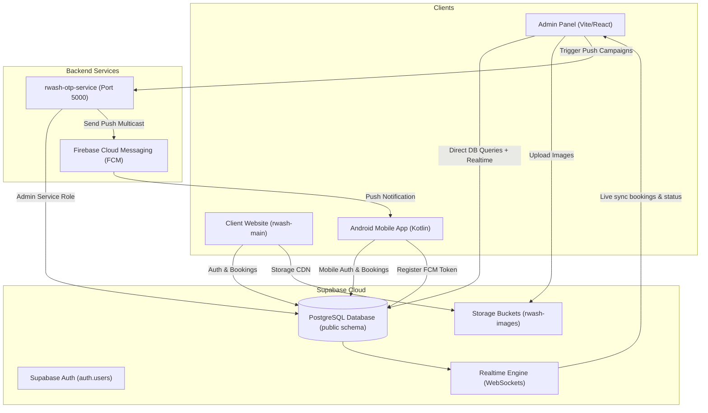
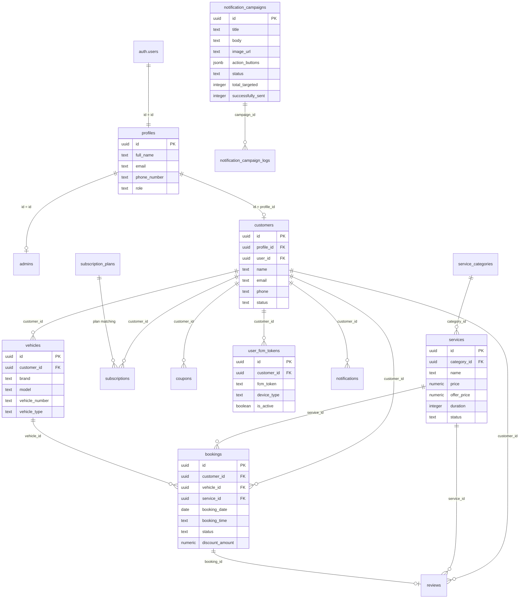

# RWash Complete Supabase Database Architecture & Design Guide

> **Project:** RWash Car Wash & Detailing Platform  
> **Supabase URL:** `https://ehwmwqqetgcbswzyhwod.supabase.co`  
> **Database Version:** PostgreSQL 15+ (Supabase Managed)  
> **Master SQL File:** [`master_supabase_production_schema.sql`](file:///c:/Users/Love%20Kush/OneDrive/डेस्कटॉप/CarWash/master_supabase_production_schema.sql)

---

## 1. System Database Architecture Overview

RWash ka database architecture **3 main clients** ko seamlessly serve karta hai:
1. **Admin Panel** (`rwash-admin` - React + Vite + Tailwind)
2. **Customer Web App** (`rwash-main` - React + Vite + Tailwind)
3. **Android Mobile App** (`com.example.rwash` - Kotlin + Supabase SDK + FCM)
4. **Backend Daemon / OTP Service** (`rwash-otp-service` - Node.js Express)



---

## 2. Entity-Relationship Diagram (ERD)



---

## 3. Complete Table Dictionary (All 19 Tables)

### 3.1. User & Identity Management

#### `public.profiles`
Links directly 1-to-1 with Supabase `auth.users`.
| Column | Type | Constraints | Description |
|---|---|---|---|
| `id` | `UUID` | Primary Key, References `auth.users(id)` | User unique UUID from auth |
| `full_name` | `TEXT` | NOT NULL | User's full display name |
| `email` | `TEXT` | NOT NULL, UNIQUE | User email address |
| `phone_number` | `TEXT` | Nullable | Primary contact number |
| `avatar_url` | `TEXT` | Nullable | Profile photo URL |
| `address` | `TEXT` | Nullable | Saved home address |
| `city` | `TEXT` | Nullable | City name |
| `role` | `TEXT` | NOT NULL, Default `'Customer'` | `'Admin'` or `'Customer'` |
| `created_at` | `TIMESTAMPTZ` | Default `now()` | Registration date |
| `updated_at` | `TIMESTAMPTZ` | Default `now()` | Last profile update |

#### `public.admins`
List of administrator profiles with elevated privileges.
| Column | Type | Constraints | Description |
|---|---|---|---|
| `id` | `UUID` | Primary Key, References `profiles(id)` | Admin UUID |
| `email` | `TEXT` | NOT NULL, UNIQUE | Admin login email |
| `created_at` | `TIMESTAMPTZ` | Default `now()` | Timestamp |

#### `public.customers`
Customer entity supporting both authenticated users and walk-in/guest customers.
| Column | Type | Constraints | Description |
|---|---|---|---|
| `id` | `UUID` | Primary Key, `gen_random_uuid()` | Customer record ID |
| `profile_id` | `UUID` | Nullable, References `profiles(id)` | Link to user profile |
| `user_id` | `UUID` | Nullable, References `auth.users(id)` | Link to auth account |
| `name` | `TEXT` | NOT NULL | Customer name |
| `email` | `TEXT` | Nullable | Customer email |
| `phone` | `TEXT` | Nullable | Phone number |
| `avatar_url` | `TEXT` | Nullable | Customer avatar |
| `status` | `TEXT` | Default `'Active'` | `'Active'`, `'Inactive'`, `'Suspended'` |
| `created_at` | `TIMESTAMPTZ` | Default `now()` | Creation timestamp |

---

### 3.2. Vehicle Fleet & Services Catalog

#### `public.vehicles`
Customer registered vehicles.
| Column | Type | Constraints | Description |
|---|---|---|---|
| `id` | `UUID` | Primary Key | Vehicle UUID |
| `customer_id` | `UUID` | NOT NULL, References `customers(id)` | Vehicle owner |
| `brand` | `VARCHAR(100)` | NOT NULL | Brand (e.g. Hyundai, Toyota) |
| `model` | `VARCHAR(100)` | NOT NULL | Model (e.g. Creta, Fortuner) |
| `vehicle_number`| `VARCHAR(50)` | NOT NULL | Registration license plate |
| `color` | `VARCHAR(50)` | NOT NULL | Vehicle color |
| `vehicle_type` | `VARCHAR(50)` | NOT NULL | `'Sedan'`, `'SUV'`, `'Hatchback'`, `'Luxury'`, `'Bike'` |
| `image_url` | `TEXT` | Nullable | Car photo |
| `created_at` | `TIMESTAMPTZ` | Default `now()` | Date added |

#### `public.service_categories`
Groupings for car wash packages.
| Column | Type | Constraints | Description |
|---|---|---|---|
| `id` | `UUID` | Primary Key | Category UUID |
| `name` | `TEXT` | NOT NULL, UNIQUE | Category name (Basic, Premium, etc.) |
| `description` | `TEXT` | Nullable | Category summary |
| `icon` | `TEXT` | Nullable | Lucide icon identifier |
| `color` | `TEXT` | Default `'#6366f1'` | Accent color hex |
| `created_at` | `TIMESTAMPTZ` | Default `now()` | Creation date |

#### `public.services`
Car wash and detailing packages.
| Column | Type | Constraints | Description |
|---|---|---|---|
| `id` | `UUID` | Primary Key | Service UUID |
| `name` | `TEXT` | NOT NULL | Service title |
| `category_id` | `UUID` | Nullable, References `service_categories(id)` | Parent category |
| `category` | `TEXT` | Nullable | Human readable category string |
| `description` | `TEXT` | Nullable | Full service description |
| `features` | `TEXT` | Nullable | JSON string or newline features |
| `price` | `NUMERIC(10,2)`| NOT NULL, `>= 0` | Regular base price |
| `offer_price` | `NUMERIC(10,2)`| Nullable, `>= 0` | Discounted promo price |
| `duration` | `INTEGER` | NOT NULL, Default `45` | Time required in minutes |
| `image_url` | `TEXT` | Nullable | Banner/service photo URL |
| `status` | `TEXT` | Default `'Active'` | `'Active'` or `'Inactive'` |
| `created_at` | `TIMESTAMPTZ` | Default `now()` | Creation date |
| `updated_at` | `TIMESTAMPTZ` | Default `now()` | Auto-updated |

---

### 3.3. Bookings & Reviews

#### `public.bookings`
Service appointment bookings with geolocation and coupon support.
| Column | Type | Constraints | Description |
|---|---|---|---|
| `id` | `UUID` | Primary Key | Booking UUID |
| `customer_id` | `UUID` | Nullable, References `customers(id)` | Booking customer |
| `vehicle_id` | `UUID` | Nullable, References `vehicles(id)` | Customer vehicle |
| `vehicle_type` | `TEXT` | NOT NULL, Default `'Sedan'` | Snapshot of car type |
| `service_id` | `UUID` | Nullable, References `services(id)` | Booked service |
| `booking_date` | `DATE` | NOT NULL | Scheduled service date |
| `booking_time` | `TEXT` | NOT NULL | Time slot (e.g. `'10:00 AM'`) |
| `address` | `TEXT` | Nullable | Doorstep service address |
| `latitude` | `DOUBLE PRECISION`| Nullable | GPS latitude |
| `longitude` | `DOUBLE PRECISION`| Nullable | GPS longitude |
| `notes` | `TEXT` | Nullable | Special customer requests |
| `coupon_code` | `TEXT` | Nullable | Applied coupon |
| `discount_amount`| `NUMERIC` | Default `0` | Savings applied |
| `status` | `TEXT` | Default `'Pending'` | `'Pending'`, `'Confirmed'`, `'Accepted'`, `'Assigned'`, `'In Progress'`, `'Completed'`, `'Cancelled'` |
| `created_at` | `TIMESTAMPTZ` | Default `now()` | Order placed date |
| `updated_at` | `TIMESTAMPTZ` | Default `now()` | Auto-updated on status change |

#### `public.reviews`
Customer ratings & reviews for completed bookings.
| Column | Type | Constraints | Description |
|---|---|---|---|
| `id` | `UUID` | Primary Key | Review UUID |
| `booking_id` | `UUID` | NOT NULL, UNIQUE, Ref `bookings(id)` | 1 review per booking |
| `customer_id` | `UUID` | NOT NULL, References `customers(id)` | Reviewer |
| `service_id` | `UUID` | NOT NULL, References `services(id)` | Rated service |
| `rating` | `INTEGER` | NOT NULL, `1 to 5` | Star rating |
| `comment` | `TEXT` | Nullable | Review feedback |
| `created_at` | `TIMESTAMPTZ` | Default `now()` | Timestamp |

---

### 3.4. Subscriptions & Plans

#### `public.subscription_plans`
Membership plans configurable by Admin.
| Column | Type | Constraints | Description |
|---|---|---|---|
| `id` | `UUID` | Primary Key | Plan UUID |
| `name` | `TEXT` | NOT NULL | e.g. `'Basic Shield Plan'` |
| `price` | `NUMERIC` | NOT NULL | Plan fee |
| `billing_cycle`| `TEXT` | Default `'Monthly'` | `'Monthly'`, `'Quarterly'`, `'Yearly'` |
| `offer_tag` | `TEXT` | Nullable | Tag (e.g. `'🔥 20% OFF'`) |
| `features` | `JSONB` | Default `'[]'` | List of included perks |
| `is_active` | `BOOLEAN` | Default `true` | Display in app |
| `popular` | `BOOLEAN` | Default `false` | Highlighted badge |
| `created_at` | `TIMESTAMPTZ` | Default `now()` | Timestamp |

#### `public.subscriptions`
Active and past customer subscriptions.
| Column | Type | Constraints | Description |
|---|---|---|---|
| `id` | `UUID` | Primary Key | Subscription UUID |
| `customer_id` | `UUID` | NOT NULL, References `customers(id)` | Subscribed user |
| `plan_name` | `TEXT` | NOT NULL | Name of the plan |
| `price` | `NUMERIC` | NOT NULL | Price paid |
| `billing_cycle`| `TEXT` | Default `'Monthly'` | Billing duration |
| `status` | `TEXT` | Default `'Active'` | `'Active'`, `'Cancelled'`, `'Expired'`, `'Suspended'` |
| `start_date` | `TIMESTAMPTZ` | Default `now()` | Activation date |
| `end_date` | `TIMESTAMPTZ` | NOT NULL | Expiry date |
| `created_at` | `TIMESTAMPTZ` | Default `now()` | Purchase timestamp |

---

### 3.5. Marketing & Media Content

#### `public.banners`
Homepage slider banners with deep links and coupon attachments.
| Column | Type | Constraints | Description |
|---|---|---|---|
| `id` | `UUID` | Primary Key | Banner UUID |
| `title` | `TEXT` | Nullable | Banner headline |
| `image_url` | `TEXT` | NOT NULL | Image link in storage |
| `coupon_code` | `TEXT` | Nullable | Attached promo code |
| `redirect_url`| `TEXT` | Nullable | Internal route or web link |
| `is_visible` | `BOOLEAN` | Default `true` | Toggle display |
| `display_order`| `INTEGER` | Default `0` | Sequence sorting |
| `created_at` | `TIMESTAMPTZ` | Default `now()` | Timestamp |

#### `public.coupons`
Discount codes for customer checkout.
| Column | Type | Constraints | Description |
|---|---|---|---|
| `id` | `UUID` | Primary Key | Coupon UUID |
| `code` | `TEXT` | NOT NULL, UNIQUE | Code (e.g. `'WELCOME99'`) |
| `discount_amount`| `NUMERIC` | NOT NULL | Rupees discount |
| `customer_id` | `UUID` | Nullable, References `customers(id)` | Optional single-user lock |
| `is_used` | `BOOLEAN` | Default `false` | Redemption status |
| `created_at` | `TIMESTAMPTZ` | Default `now()` | Timestamp |

#### `public.blogs`
Detailing academy educational articles.
| Column | Type | Constraints | Description |
|---|---|---|---|
| `id` | `UUID` | Primary Key | Blog UUID |
| `title` | `TEXT` | NOT NULL | Article title |
| `category` | `TEXT` | NOT NULL | Category badge |
| `image_url` | `TEXT` | NOT NULL | Header cover photo |
| `description` | `TEXT` | NOT NULL | Full article body |
| `stage_number`| `TEXT` | NOT NULL | Stage label (e.g. `'Stage 01'`) |
| `created_at` | `TIMESTAMPTZ` | Default `now()` | Published date |

#### `public.gallery` & `public.offers`
Showcase photos and seasonal promotional flyers.

---

### 3.6. Firebase Push Notifications & FCM System

#### `public.notification_campaigns`
Broadcast & targeted notification campaigns managed from Admin.
| Column | Type | Constraints | Description |
|---|---|---|---|
| `id` | `UUID` | Primary Key | Campaign UUID |
| `name` | `TEXT` | NOT NULL | Internal admin campaign name |
| `description` | `TEXT` | Nullable | Admin notes |
| `title` | `TEXT` | NOT NULL | Notification title shown on phone |
| `body` | `TEXT` | NOT NULL | Notification message body |
| `image_url` | `TEXT` | Nullable | Big picture notification banner |
| `small_icon` | `TEXT` | Default `'default'` | Android notification icon |
| `action_buttons`| `JSONB` | Default `'[]'` | Action buttons `[{text, url, type}]` |
| `deep_link` | `TEXT` | Default `'/'` | Target screen on tap |
| `timer_expiry`| `TIMESTAMPTZ`| Nullable | Offer countdown timer |
| `category` | `TEXT` | Default `'Promotional'`| Notification category |
| `priority` | `TEXT` | Default `'High'` | High / Normal priority |
| `sound` | `BOOLEAN` | Default `true` | Play alert sound |
| `vibration` | `BOOLEAN` | Default `true` | Vibrate device |
| `target_audience`| `TEXT` | Default `'all'` | `'all'`, `'selected_users'`, `'segments'`, `'topics'` |
| `target_user_ids`| `JSONB` | Default `'[]'` | List of selected customer IDs |
| `target_segment`| `TEXT` | Default `'all_customers'` | User segment |
| `target_topic` | `TEXT` | Default `'all_users'` | FCM topic string |
| `scheduled_time`| `TIMESTAMPTZ`| Nullable | Future dispatch time |
| `status` | `TEXT` | Default `'Draft'` | `'Draft'`, `'Scheduled'`, `'Sending'`, `'Sent'`, `'Failed'` |
| `total_targeted`| `INTEGER` | Default `0` | Recipient count |
| `successfully_sent`| `INTEGER`| Default `0` | Delivered count |
| `failed_send` | `INTEGER` | Default `0` | Failed attempts |
| `clicked` | `INTEGER` | Default `0` | User open clicks |
| `error_log` | `TEXT` | Nullable | Error message if failed |
| `created_at` | `TIMESTAMPTZ` | Default `now()` | Timestamp |
| `sent_at` | `TIMESTAMPTZ` | Nullable | Dispatch timestamp |

#### `public.user_fcm_tokens`
Stores device tokens registered by Android apps and browsers.
| Column | Type | Constraints | Description |
|---|---|---|---|
| `id` | `UUID` | Primary Key | Token record ID |
| `customer_id` | `UUID` | Nullable, References `customers(id)` | Device owner |
| `user_id` | `UUID` | Nullable | Auth user ID |
| `fcm_token` | `TEXT` | NOT NULL, UNIQUE | Firebase device registration token |
| `device_type` | `TEXT` | Default `'android'` | `'android'`, `'ios'`, `'web'` |
| `device_model`| `TEXT` | Nullable | Device model (e.g. `'Pixel 7'`) |
| `app_version` | `TEXT` | Nullable | Mobile app version |
| `is_active` | `BOOLEAN` | Default `true` | Active token flag |
| `created_at` | `TIMESTAMPTZ` | Default `now()` | First registered |
| `last_used_at`| `TIMESTAMPTZ` | Default `now()` | Last notification sent |

#### `public.notification_campaign_logs`
Delivery audit log for individual notifications sent to each device.

---

### 3.7. Global Business Settings

#### `public.settings`
Single-row configuration (`id = 1`) controlling brand details, contact info, working hours, and automated discount settings.

---

## 4. Supabase Storage Bucket Architecture

- **Bucket Name:** `rwash-images`
- **Access Level:** `Public = true`
- **File Size Limit:** `10 MB` (10,485,760 bytes)
- **Allowed MIME Types:** `image/jpeg`, `image/png`, `image/webp`, `image/svg+xml`, `image/gif`
- **Public URL Template:**
  `https://ehwmwqqetgcbswzyhwod.supabase.co/storage/v1/object/public/rwash-images/{folder}/{filename}`

**Storage Folder Organization:**
```
rwash-images/
  ├── services/       <-- Service package illustrations
  ├── banners/        <-- Promotional home carousel banners
  ├── campaigns/      <-- Push notification banner images
  ├── vehicles/       <-- Customer car photos
  ├── avatars/        <-- User profile avatars
  └── branding/       <-- Logo and app branding
```

---

## 5. Row Level Security (RLS) & Policies

Har table par Row Level Security (RLS) active hai.
Development aur seamless sync ke liye permissive policies configured hain taaki:
- Web Admin Panel bina restrictions ke analytics, services, aur campaigns manage kar sake.
- Customer Web App aur Android App profile aur bookings smoothly read/write kar sakein.
- Backend Daemon Service Role ke saath token cleanup aur multicast dispatch kar sake.

---

## 6. Realtime Subscriptions (WebSockets)

Neeche di gayi tables Supabase `supabase_realtime` publication mein registered hain:
1. `public.bookings`: Jab customer naya booking kare ya admin status change kare (`Pending` -> `Accepted` -> `Completed`), dono screens bina refresh hue turant update ho jati hain.
2. `public.services`: Jab admin price ya availability change kare, client app par turant reflect hota hai.
3. `public.banners`: Banner upload hote hi website slider update ho jata hai.
4. `public.settings`: Contact number ya auto-discount change turant sync hota hai.
5. `public.notification_campaigns`: Campaign dispatch progress (`total_targeted`, `successfully_sent`) live animate hoti hai.

---

## 7. Migration & Deployment Files Directory

Workspace ke andar SQL files ka structure:

```
CarWash/
  ├── master_supabase_production_schema.sql  <-- [MAIN] Ek single file jisme pura complete DB hai
  ├── notification_campaigns_schema.sql      <-- Push Notification system schema
  ├── setup_subscription_plans.sql           <-- Subscriptions & plans
  ├── banner_category_upgrade.sql            <-- Banners & categories
  ├── whatsapp_mobile_login_upgrade.sql      <-- Phone number login support
  ├── fix_storage_rls.sql                    <-- Storage bucket & image upload policies
  ├── fix_bookings_rls.sql                   <-- Bookings permissive policies
  └── enable_realtime.sql                    <-- Realtime publication config
```

### How to Run in Supabase:
1. Supabase Dashboard open karein: `https://supabase.com/dashboard/project/ehwmwqqetgcbswzyhwod`
2. Left menu se **SQL Editor** par click karein.
3. **+ New query** par click karein.
4. [`master_supabase_production_schema.sql`](file:///c:/Users/Love%20Kush/OneDrive/डेस्कटॉप/CarWash/master_supabase_production_schema.sql) ka content copy-paste karein.
5. **Run** button press karein. Pura database automatically setup ho jayega!

